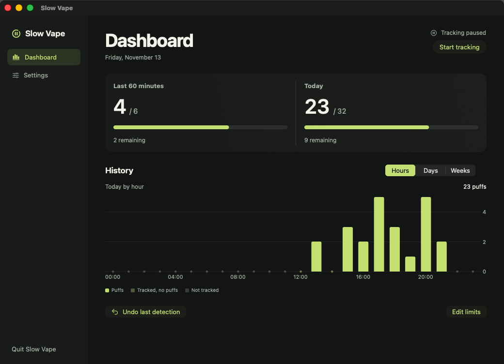
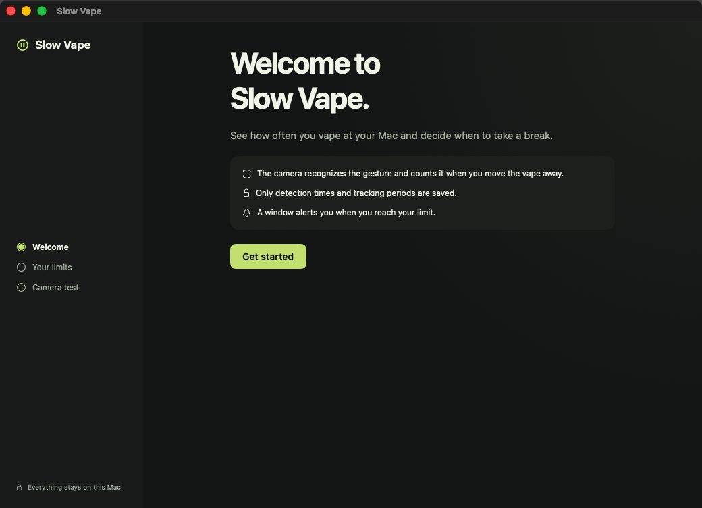
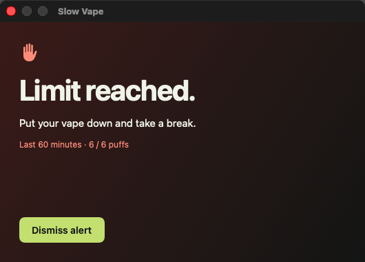

# Slow Vape

Slow Vape is a native macOS app that uses your webcam to count likely vaping gestures and alerts you when you reach a limit you set. Detection, settings, and history all run locally on your Mac.



*The screenshots use sample data.*

## What it does

- **Tracks vaping gestures.** The camera looks for a vape near your lips and counts the gesture when you move it away. A hand tracker helps when your grip partially hides the vape.
- **Tracks two limits.** Set a rolling limit for the last 60 minutes and a daily limit that resets at local midnight. You can use either, both, or neither.
- **Brings the alert to the foreground.** The limit window stays open until you dismiss it. You can adjust the sound, mute it, and preview the alert in Settings. Another detection can reopen it after 15 minutes if you are still at the limit. An optional macOS notification warns you at 80%.
- **Shows your history.** Review today by hour, the last 14 days, or the last eight weeks. The chart distinguishes periods with no tracking from tracked periods with zero detections. Use **Undo last detection** to correct a false positive.
- **Runs from the menu bar.** Click the Slow Vape icon to reopen the dashboard. Closing the window keeps tracking active. Quitting the app stops it.
- **Speaks English and French.** Slow Vape follows your macOS language preferences, or the language selected for Slow Vape in **System Settings → General → Language & Region**. English is the fallback. Relaunch the app after changing the language.

## Build and run from source

You need an **Apple silicon Mac**, **macOS 14 or later** to run the app, and **Xcode 26 or later** with its command-line tools selected to build it.

```bash
git clone https://github.com/damsltc57/slow-vape.git
cd slow-vape
./scripts/build-app.sh
open "dist/Slow Vape.app"
```

The build script compiles the Swift app, packages the Core ML model and both translations, and applies a local ad hoc signature. The build and the app need no API keys, accounts, or package downloads. Use the built `.app` to run Slow Vape so macOS can load its resources and camera permission prompt.

To run the automated checks for counting, history, and alert thresholds:

```bash
swift test
```

## First run

1. Open **Slow Vape** and select **Get started**.
2. Enter the puff limits you want. Leave a field blank to disable that limit.
3. On **Camera test**, select **Start camera** and grant access when macOS asks. At your usual distance from the camera, bring the vape to your lips and move it away. You can test the gesture without inhaling. Test detections stay out of your history.
4. Open the dashboard. Select **Start tracking** if tracking is paused. Use **Pause tracking** whenever you want to stop the camera.

If camera access is denied, enable Slow Vape in **System Settings → Privacy & Security → Camera**. **Settings → Camera and startup** includes a live preview, detection sensitivity, and separate options to open Slow Vape at login and start tracking when it opens.



## Alerts

Open **Settings → Alerts** to adjust the volume, play the sound, preview the window, or enable the optional 80% notification.



## Privacy and detection limits

Slow Vape processes camera frames in memory using Apple Vision and Core ML. It stores detection timestamps, tracking intervals, and preferences in its local macOS app container. It does not record camera footage or require internet access.

The counter estimates gestures. It may miss a puff when the vape is hidden or the face is out of frame, and it may occasionally mistake another object for a vape. Multiple puffs without moving the vape away may register as one gesture.

## Source, contributions, and licensing

The repository contains the Swift app, camera pipeline, local history and alert rules, build script, and English and French resources. Fork the repository to propose changes, run the tests before opening a pull request, and include macOS version and reproduction steps in bug reports. Please avoid attaching private camera footage to public issues.

Slow Vape’s application code is licensed under the [GNU Affero General Public License v3.0 only](LICENSE) (`AGPL-3.0-only`). The source for the app, its build scripts, and its resources is available in this repository.

The upstream detector checkpoint identifies its license as **AGPL-3.0**. See the [model license](Resources/Model-LICENSE.txt), [source project](https://github.com/saqibhakeem/Cigarette-and-Vape-Detection-system/tree/af7de3f0dd4cb9aa6070b92fe515355522c9474e), and [original checkpoint](https://raw.githubusercontent.com/saqibhakeem/Cigarette-and-Vape-Detection-system/af7de3f0dd4cb9aa6070b92fe515355522c9474e/best.pt). The [conversion script](scripts/export_model.py) verifies the checkpoint checksum and exports it to Core ML. Its known toolchain is Python 3.13, PyTorch 2.8.0, torchvision 0.23.0, Ultralytics 8.3.228, coremltools 9.0, and NumPy 2.2.6. The Core ML export is already bundled for ordinary builds.
